# 开发与服务器管理工作台 / DevServerManager

<p align="center">
  <a href="https://github.com/YOUR_GITHUB_NAME/dev-server-manager/actions/workflows/ci.yml"></a>
  <a href="LICENSE"></a>
  = 18" />
  
  
</p>

> **EN** — A local-first DevOps workbench for managing development projects, ports, processes, remote servers and Docker containers.
>
> **中文** — 一个面向个人开发者的本地项目、端口、进程、服务器与 Docker 统一管理工作台。

**本地优先（local-first）**：数据全部写在本机的可读 JSON 里——不联网上报、没有数据库、没有账号体系。
服务是否"正在运行"不读任何缓存记录，而是每次刷新都向 Windows 真实监听表（`Get-NetTCPConnection`，失败回退 `netstat`）核对 PID、端口与进程；远程侧只做**只读**采集（一条固定的采集脚本 + 白名单日志路径），界面上没有任何命令输入框。

一个页面回答四个问题：**哪个项目在跑 · 它占了哪个端口 · 这个端口对应什么应用 · 文件在哪台机器的哪个路径**，并可直接启动 / 停止 / 重启 / 打开目录 / 打开网页 / 看日志。

## 核心能力

| 能力 | 说明 | 详见 |
| --- | --- | --- |
| **真实 PID / 端口检测** | 端口状态来自系统实时监听表，不是数据库标记；沿父进程链比对，`npm run dev` → `node` 这种套壳进程也能认出是谁在监听；停止时结束整棵进程树并校验端口真的释放 | 第十一节 |
| **本地服务自动发现** | 扫描监听端口的进程目录，读 `package.json` / `pyproject.toml` 等元数据识别技术栈并给出启动命令建议；**只读元数据文件，绝不执行项目脚本**；候选可登记 / 忽略 / 交给 AI 辅助识别（默认关闭） | 第八节 |
| **多端口项目聚合** | 同一目录下的多个进程与端口（前端 / 后端 / worker / 调试端口）归为一个项目卡片，整体状态四值判定（全部运行 / 部分运行 / 全部停止 / 存在冲突）；扫出新端口只提示"发现新的子服务"，不会重复建项目 | 第九节 |
| **SSH 只读监控** | 采集 CPU / 内存 / 磁盘 / 负载 / 运行时长 / 监听端口，与本地记录做端口核对；日志读取限定白名单路径；密码与私钥口令永不入库 | 第六节 |
| **Docker 只读监控** | 通过 SSH 执行 `docker ps` 类查询命令列出容器状态与健康度，与 APP 记录做三类核对；不执行任何写操作 | 第七节 |
| **服务生命周期时间线** | 只在状态真的变化时记一条（启动 / 停止 / 异常退出 / 恢复 / 端口冲突 / 发现新服务 / SSH 在线离线 / Docker 变化…），每条带端口、PID、进程名、退出码等事实字段；不做每秒快照 | 第十节 |
| **本地影院托管** | 把「本地私人影院 2.0」（海报墙 + 点开即播 + Real-ESRGAN 超分 + 聚合搜索 + yt-dlp 入库）作为独立 Python 子进程托管：启动 / 停止 / 探活 / 认领 / 打开片库 / 日志，运行态整页内嵌；能力标志以影院自己的接口为准 | 二十节 |

## 架构

```text
浏览器（React 18 + Vite 构建产物，由后端静态托管）
        │  HTTP / SSE（仅监听 127.0.0.1）
        ▼
Express API ── routes/  参数校验与响应封装
        │
        ├─ services/   业务与采集
        │   ├─ portScanner / processInfo / processManager   真实监听表 · 进程树 · 启停
        │   ├─ projectService / projectGrouping             项目视图与多端口聚合
        │   ├─ processInspector / projectDetector /
        │   │  serviceClassifier / aiIdentifier /
        │   │  localDiscoveryService                        自动发现（只读元数据）
        │   ├─ sshClient / sshMetrics / dockerMetrics /
        │   │  serverMonitor                                SSH 与 Docker 只读采集
        │   ├─ mappingService / dashboardService /
        │   │  searchService                                端口映射 · 总览 · 全站搜索
        │   └─ eventService                                 状态指纹去抖 → 生命周期事件
        │
        └─ store/      JSON 仓储（内存缓存 + 串行原子写入 + 损坏文件自动备份）
                       projects · servers · runtime · discovery · events · logs
                       └─ data/*.json（本机文件，无数据库；已 gitignore）
```

后端零外部服务依赖：只有 `express`、`cors`、`ssh2` 三个运行时依赖；Windows 侧调用系统自带的 `Get-NetTCPConnection` / `tasklist` / `taskkill`，不引入 WMI 或第三方原生模块。

## 版本状态

v0.1.0 已完成六个阶段：①项目与端口启停 → ②SSH 只读监控 → ③Docker 容器状态 → ④本地服务自动发现 → ⑤按目录聚合的项目/子服务 → ⑥服务生命周期时间线（只记录变化）。

明确**不做**（不在本项目的范围内）：登录 / 权限 / 多用户 / 云同步、CPU 与内存历史曲线、全盘端口扫描、后台高频轮询（时间线靠各视图刷新时做状态比对，不每秒快照）、任何远程写操作。
更细的取舍记录在 [CHANGELOG.md](CHANGELOG.md)，改动方式见 [CONTRIBUTING.md](CONTRIBUTING.md)。

## 一、快速开始

环境要求：Windows 10/11 + Node.js 18 以上（开发机实测 Node v24.16.0 / npm 12.0.2）。

**方式一：一键启动（推荐）**

双击 `start.bat`（或在项目根目录执行 `npm start`）。
它会自动完成：检查依赖（缺失则 `npm install`）→ 需要时构建前端 → 启动服务 → 打开浏览器。

访问地址：<http://127.0.0.1:8787>

**方式二：开发模式（改代码即时生效）**

双击 `dev.bat`（或 `npm run dev`）：后端 8787 + Vite 5180（热更新，`/api` 自动代理）。

访问地址：<http://localhost:5180>

**方式三：桌面端（独立应用窗口，推荐日常使用）**

先安装一次桌面快捷方式：

```bash
npm run shortcut
```

之后**双击桌面「开发与服务器管理工作台」图标**即可：后端没在跑会自动拉起，并以
Edge/Chrome 的 **app 窗口模式**打开——没有地址栏、没有标签页、独立任务栏图标，观感等同原生桌面程序。

| 命令 | 说明 |
| --- | --- |
| `npm run desktop` | 命令行拉起桌面窗口（等价于双击图标） |
| `npm run desktop -- --kill` | 停止后端（关闭窗口**不会**停后端，因为它可能正托管你启动的项目） |
| `npm run shortcut` | 生成图标 + 创建桌面与开始菜单快捷方式 |
| `npm run shortcut:remove` | 删除快捷方式 |

> 为什么用浏览器 app 模式而不是 Electron：后端本身要依赖大量 Node 能力（PowerShell、SSH、子进程），
> 且只监听 `127.0.0.1`；Electron 还要再嵌一个 Chromium 并打包，体积与复杂度都上一个台阶。
> app 模式用系统已装的浏览器，**零额外依赖**，窗口体验一致。
> 用户数据目录独立在 `data/.desktop-profile`，不污染也不受你日常浏览器的扩展与登录态影响。

**开始使用前的准备：清除示例数据**

首次运行会播种 6 个示例项目与 3 台示例服务器（占位 IP，必然连不上、只会产生失败日志）。
正式使用前建议清掉：

```bash
node scripts/clear-demo.mjs --dry-run   # 先看会删什么（判定依据见下）
node scripts/clear-demo.mjs             # 执行，自动整目录备份到 data-backup-<时间>/
```

判定口径保守，**宁可少删**：项目按「目录是否真实存在」判断；服务器按 `remark` 是否以「示例数据」开头判断
（占位 IP 形态只是辅助——用户可能把示例项改成自己的，所以不能只看 IP）。
派生缓存（上次扫描、熔断记录、指向已删对象的事件、孤立项目日志）一并清理；
事件只删条目、**保留状态指纹**，否则清空后一瞬间会把现状全当成"刚刚变化"重放一遍。

> 必须先停后端再清除：`jsonStore` 有内存缓存，后端在跑时改磁盘会被下一次写入覆盖回去。

**常用命令**

| 命令 | 说明 |
| --- | --- |
| `npm start` | 生产式启动：构建前端 + 单端口 8787 提供页面与 API |
| `npm run dev` | 开发模式：8787(API) + 5180(Vite) |
| `npm run build` | 只构建前端到 `web/dist` |
| `npm run install:all` | 安装前后端依赖 |
| `npm run api` | 只启动后端 API |
| `npm run desktop` | 桌面应用窗口模式（见方式三） |
| `npm run exec -- "<命令>"` | 本地命令执行器 CLI（支持 `--detach` 拉起长驻服务） |
| `npm test` | 全量回归（15 个脚本 / 831 项断言） |
| `npm run ui` | 逐视图截图 + 收集控制台错误 + 反装饰探针 |

环境变量（可选）：`DSM_PORT`（API 端口，默认 8787）、`DSM_FORCE_BUILD=1`（强制重建前端）、`DSM_NO_OPEN=1`（启动后不自动开浏览器）。

---

## 二、页面总览

| 页面 | 内容 |
| --- | --- |
| **总览** | 顶部统计卡（本地运行中 / 在线服务器 / 已记录端口 / 端口冲突 / 运行·停止·异常容器）；下面是本地项目与服务、最近日志与实时事件、**服务生命周期时间线（最近变化）**、服务器资产、端口映射、服务器应用关系 |
| **本地项目** | 按项目目录聚合的「项目卡片 + 子服务列表」：卡片显示项目名、路径、整体状态、技术栈、端口数量、运行进程数量；按钮：启动 / 停止 / 重启 / 打开目录 / 打开网页 / 日志 / 编辑 / 删除；展开后逐行显示所有真实监听端口与进程（支持关联 / 忽略新子服务），卡片底部是该项目的时间线；支持按状态筛选与关键字搜索 |
| **服务器** | 服务器资产（名称、IP、系统、SSH 端口、探测状态、备注），展开后是该机的 APP 表（端口 / APP / 部署路径 / 状态 / 操作），支持服务器与 APP 的增删改 |
| **端口映射** | 全局一张表：端口 / 应用·服务 / 环境（本地/服务器）/ 所属项目或服务器 / 文件路径或部署路径 / 状态；可对任意端口做「实测归属」查询；顶部汇总冲突明细 |
| **日志中心** | 工作台事件（启停、端口冲突、探测结果）与各项目进程输出（stdout+stderr）；支持实时追踪（SSE）、清空、切换来源 |
| **事件时间线** | 服务生命周期变化的过滤视图：按项目 / 服务器（二选一）、类型（带计数）、关键字筛选，每条事件带端口、PID、进程名等事实 |
| **网盘直链** | 10 家网盘分享链接 → 直链，三个出口任选：复制 / 推送到 aria2 / 下载到本机（断点续传），支持按文件勾选与迅雷验证码回填 |
| **本地影院** | 把「本地私人影院 2.0」（海报墙 + 点开即播 + Real-ESRGAN 逐帧超分 + Apple CMS 聚合搜索 + yt-dlp 下载入库）接进工作台：一键启动 / 停止 / 探活 / 打开片库目录 / 看日志，运行态整页内嵌影院本体（只听 127.0.0.1）；能力徽标（AI 修复 / 自动海报 / 下载入库）以影院自己的接口为准 |
| **设置** | 数据目录与文件位置、运行环境信息、打开数据目录、重置运行态、恢复示例数据 |

顶部搜索框（快捷键 `Ctrl+K`）是全站搜索：输入 `8000` 能找到端口与对应项目，输入 `Dify` 能找到服务器、端口和部署目录，输入路径片段也能定位项目。

---

## 三、界面预览

| 页面 | 截图 |
| --- | --- |
| 总览 Dashboard | 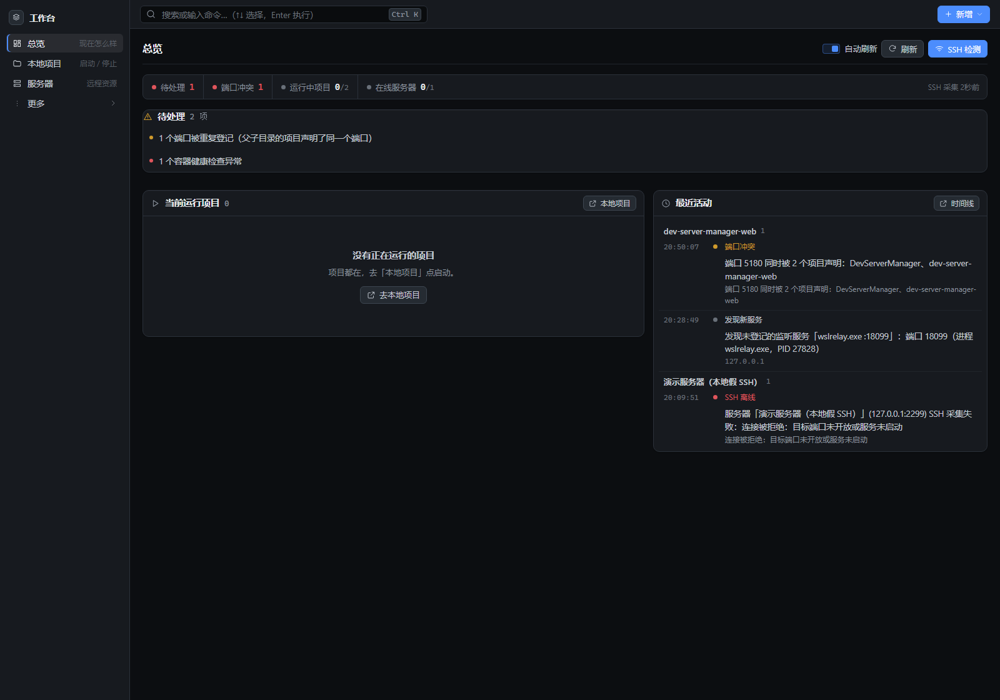 |
| 本地项目（项目卡片 + 子服务） | 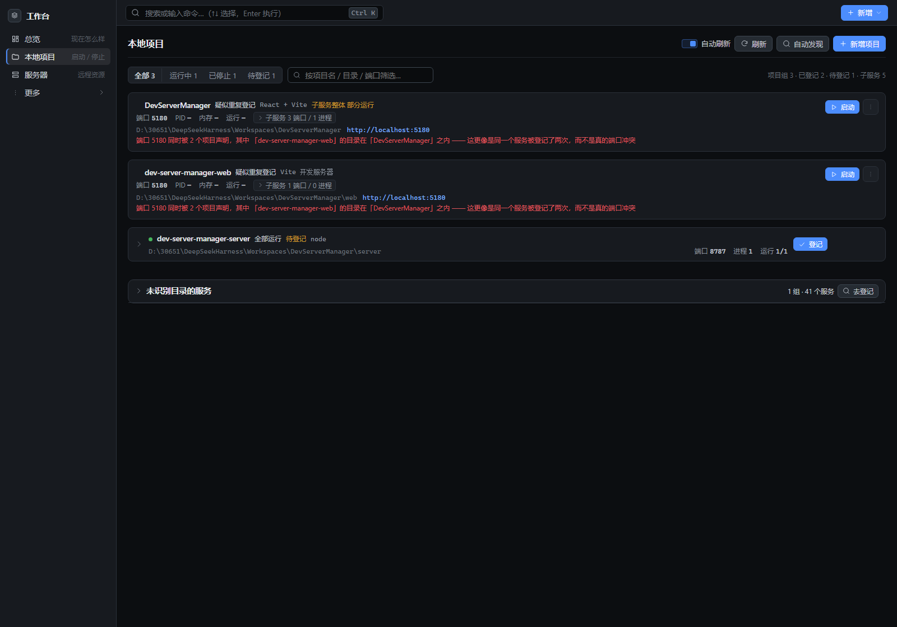 |
| 项目展开：子服务端口与该项目的时间线 | 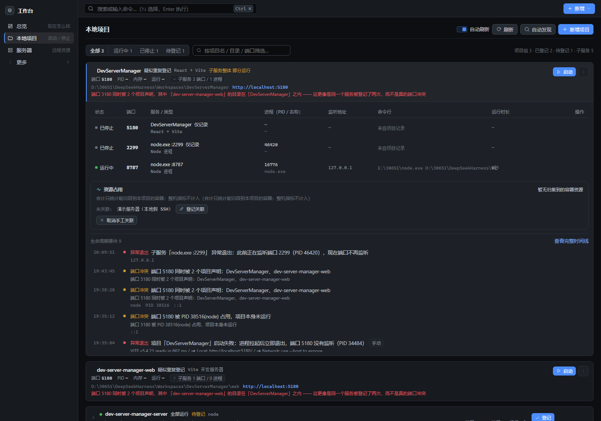 |
| 自动发现（按目录聚合） | 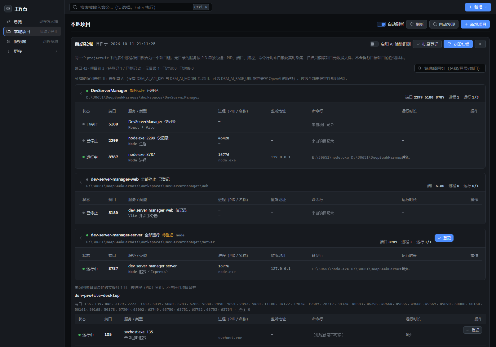 |
| 端口映射 | 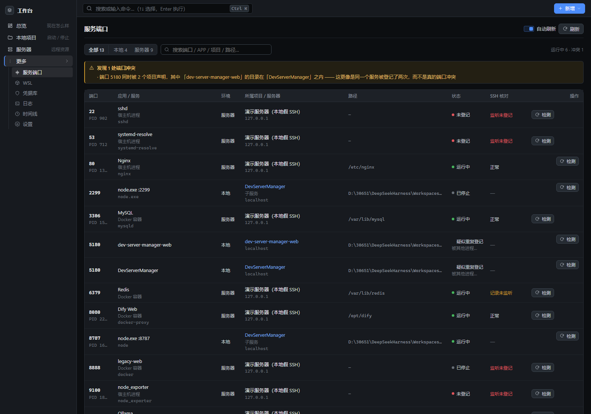 |
| 服务器资产 | 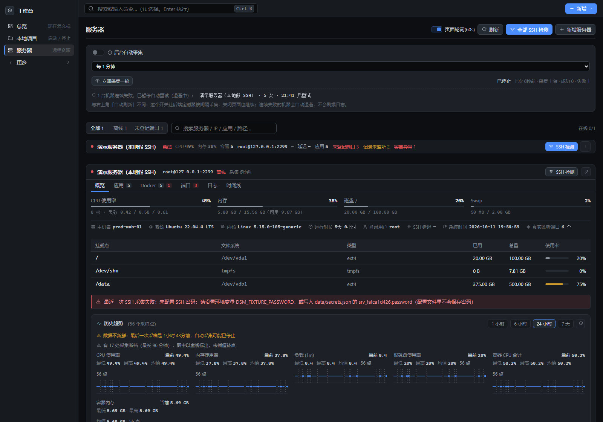 |
| Docker 容器（只读） | 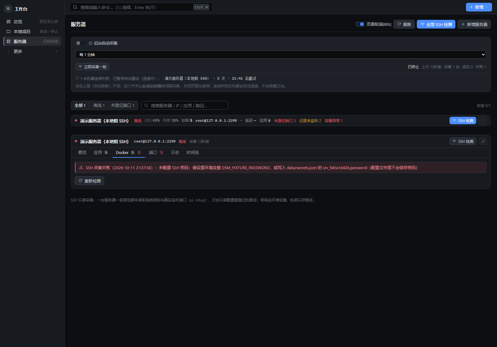 |
| 事件时间线（空状态） | 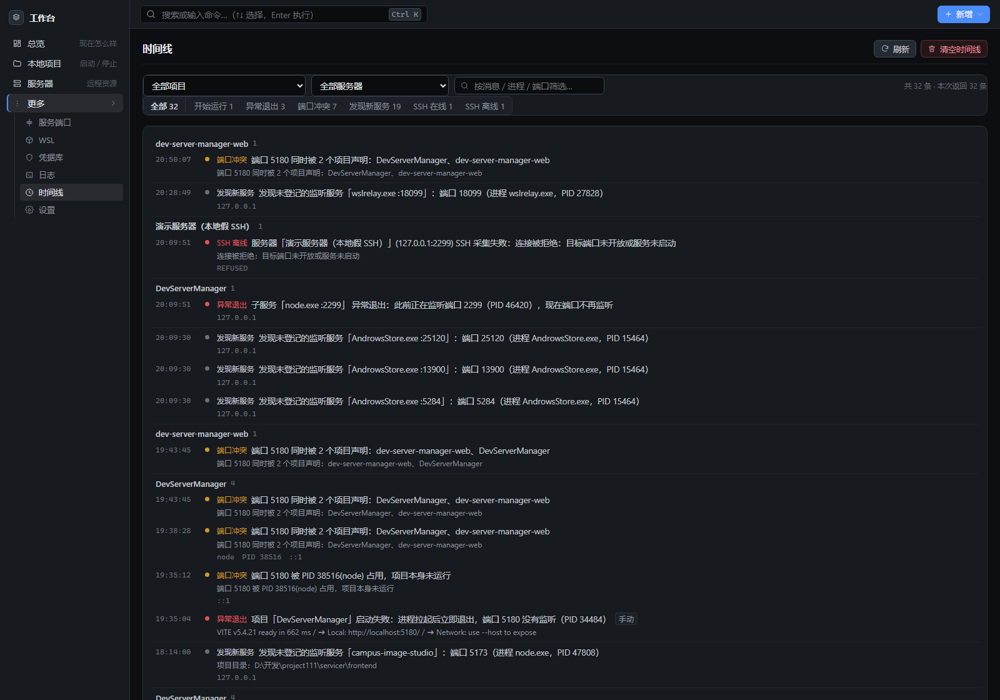 |
| 日志中心 | 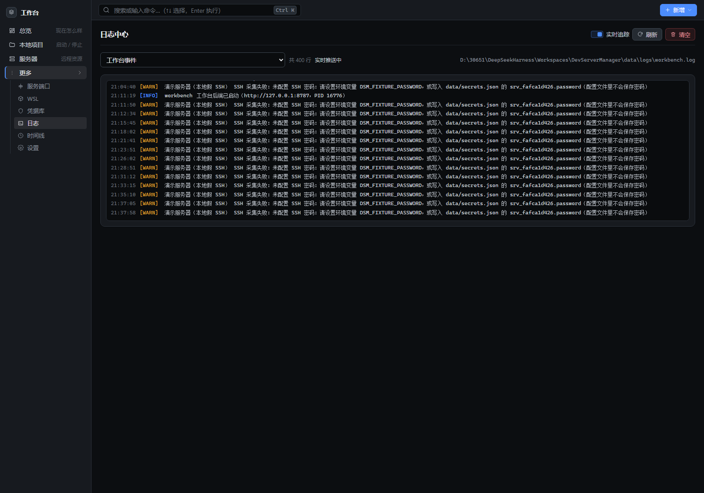 |
| 设置 | 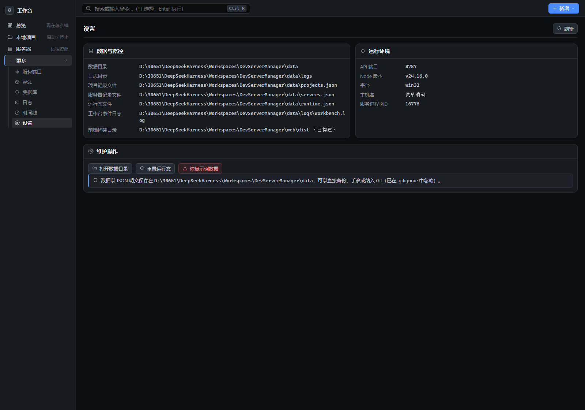 |

截图由 `node server/test/ui-snapshot.mjs` 自动巡检生成（顺带收集每个页面的控制台错误；全新克隆下 12 个页面 0 JS 报错，只有示例服务器离线时那条预期的 502 资源日志）。
**截图来自一份全新克隆**：仓库自带 6 个示例项目与 3 台示例服务器（IP 用 RFC 5737 文档保留地址），所以服务器都是离线、时间线是空的——时间线只在状态真的变化时才记一条，刚装好没有历史，这是设计如此，不是坏掉。你自己跑起来以后，页面里显示的就是你本机的真实项目与端口。

---

## 四、安全与隐私设计

| 边界 | 具体做法 |
| --- | --- |
| **只监听回环地址** | 后端 `app.listen(PORT, '127.0.0.1')`（`DSM_HOST` 可改，但工作台没有登录与权限体系，**不要把它暴露到公网或共享网络**） |
| **凭据永不入库** | 服务器配置里只有 `passwordEnv` / `passphraseEnv` 变量名和私钥**路径**；真实密码/口令从环境变量或 `data/secrets.json` 读取，两者都在 `.gitignore` 里。带 `password` / `privateKey` 字段的保存请求会被后端直接拒绝 |
| **远程只读** | SSH 连接后只执行**一条固定的采集脚本**（`hostname` / `/proc/stat` / `df` / `ss` 之类），没有任何命令输入框；日志读取走 SFTP 且限定在 `logPaths` 白名单内，越权路径返回 403。测试用假 SSH 服务器会记录"客户端到底发了什么命令"，断言不存在任意命令执行通道 |
| **Docker 只查询** | 只执行 `command -v docker`、`docker info`、`docker ps`、`docker inspect`、`docker stats --no-stream` 等查询命令，没有 `stop` / `rm` / `exec` |
| **自动发现不执行代码** | 扫描只读端口表与进程信息，读 `package.json` / `pyproject.toml` / `docker-compose.yml` 等元数据文件判断技术栈，**不会执行任何项目脚本**（端到端测试专门断言了这一点） |
| **AI 辅助识别默认关闭** | 只有你显式配置 `DSM_AI_API_KEY` + `DSM_AI_MODEL` 才会启用；请求里只带单个候选的端口、进程名、命令行、工作目录与规则已识别出的栈，不带文件内容，端点由你自己指定（默认兼容 OpenAI 接口） |
| **不误杀进程** | 停止项目时只结束该项目的进程树；系统进程（`explorer` / `svchost` 等）与工作台自身进程有白名单保护，端口兜底清理前逐个校验 |
| **数据留在本机** | 全部状态写在 `data/*.json`（可读、可手改、可整体备份），无数据库、无遥测、无云同步；写入用"临时文件 + 改名"的原子方式，读到损坏文件会先备份再重建 |
| **不无限增长** | 事件、日志、候选都有容量上限与淘汰策略，文本字段有长度上限，未知类型直接丢弃，不会把外部输入原样写进文件 |

发现漏洞请按 [SECURITY.md](SECURITY.md) 私密报告；凭据管理约定见 [data/secrets.example.json](data/secrets.example.json)。

---

## 五、测试与质量

`npm test` 顺序跑完 **26 个测试脚本、1391 项断言**。

本机（Windows 11 + 常开本机代理）实跑 **1323 通过 / 2 失败**，两条都是环境相关的已知噪声，与本轮改动无关：

- `ssh-e2e` 的「连接超时被捕获」在本机拿到 `SSH_ERROR` 而不是 `TIMEOUT` / `UNREACHABLE`（代理把不可达地址变成了连接错误）；
- `project-lifecycle` 的「占用者 80 仍在」：本机 80 端口另有服务占用，测试起的占位进程被系统回收。

CI 在干净环境跑同一条命令。

| 脚本 | 阶段 | 断言 | 覆盖内容 |
| --- | --- | --- | --- |
| `project-lifecycle.test.mjs` | ① | 48 | 真实启停、端口检测、端口避让、端口漂移、日志落盘、删除清理 |
| `start-diagnosis.test.mjs` | ① | 38 | 启动失败归因：端口被占 / 命令不存在 / 立刻退出 / 依赖缺失 |
| `ssh-parser.test.mjs` | ② | 40 | 采集脚本输出解析（CPU / 内存 / 磁盘 / 负载 / 端口） |
| `docker-parser.test.mjs` | ③ | 65 | `docker ps` / `inspect` / `stats` 解析与健康度 |
| `docker.test.mjs` | ③ | 9 | 容器只读接口与错误处理 |
| `ssh-e2e.test.mjs` | ②③ | 73 | 假 SSH 服务器端到端：连接 → 采集 → 端口核对 → SFTP 读日志，并断言命令集合只含只读脚本 |
| `discovery.test.mjs` | ④ | 92 | 项目探测、规则分类、AI 结果合并的安全边界 |
| `discovery-e2e.test.mjs` | ④ | 59 | 真实进程扫描，断言不执行项目脚本 |
| `project-detect.test.mjs` | ④ | 43 | 按目录 / 地址反查项目：元数据识别、启动命令建议、拒绝猜测 |
| `project-import.test.mjs` | ④ | 47 | 批量导入：字段校验、重复处理、失败不中断整批 |
| `grouping.test.mjs` | ⑤ | 72 | 同目录 / 同进程多端口 / 同名不同目录 / 无目录 / 系统服务 / 冲突 / 新子服务 |
| `grouping-e2e.test.mjs` | ⑤ | 58 | 多进程多端口端到端：登记项目组、关联、忽略、批量登记 |
| `events.test.mjs` | ⑥ | 95 | 十种事件类型、状态指纹去抖、事实字段、容量淘汰、记录失败不影响主流程 |
| `events-e2e.test.mjs` | ⑥ | 57 | 真实启停与崩溃、新端口、冲突、SSH 失败、Docker 变化 |
| `executor.test.mjs` | 工程 | 25 | 本地命令执行器：输出捕获、中文编码、超时杀树、ENOENT 翻译、detached 日志捕获 |
| `port-conflict.test.mjs` | 工程 | 29 | 端口冲突识别：占位者归属、只读探测、不误杀他人进程 |
| `project-resource.test.mjs` | ⑦ | 37 | 资源归集：端口关联、显式关联优先、拒绝名称猜测、整机指标不计入合计 |
| `project-link-e2e.test.mjs` | ⑦ | 22 | 显式关联端到端：登记 / 幂等 / 取消 / 归集生效 / 404 校验 |
| `auto-monitor.test.mjs` | ⑦ | 56 | 后台自动采集：目标筛选、熔断退避、日志不刷屏、设置钳制、**并发不丢计数** |
| `resource-history.test.mjs` | ⑦ | 77 | 资源历史：只存真实采样、去抖、失败不记点、尖峰冷却、断档不插值、环形裁剪、并发不丢点 |
| `vault.test.mjs` | 凭据 | 77 | 加密往返、密码错误必报错、参数自描述、篡改检出、锁定清内存、改密码后恢复密钥重建 |
| `vault-backup.test.mjs` | 凭据 | 46 | 凭据库备份与恢复：完整性校验、旧文件保留、失败不破坏原库 |
| `server-quick-fill.test.mjs` | 服务器 | 56 | 粘贴 ssh 命令 / 连接串 / config 片段的字段识别，非法值丢弃不猜 |
| `wsl.test.mjs` | WSL | 29 | 发行版枚举（跳过内部发行版）、`ss` 两种异常格式解析、无 WSL 时的优雅失败 |
| `pans.test.mjs` | 网盘 | 88 | 三个出口：aria2 报文（token 前缀 / options.header / 同名去重 / 非 http 拒绝）、错误翻译、**不经过本机代理**、下载任务进度解析与取消、目录校验（盘符 / 系统目录 / 无盘符根路径）、内嵌副本 CLI 契约 |
| `media.test.mjs` | 影院 | 53 | 托管生命周期：认领（响应头 `Server: LocalCinema/2.0` 签名 / 死 PID 残留清理）、端口避让、能力探测（强制 `Connection: close` 避开 keep-alive 复用竞态）、真 Python 假 server.py 端到端、日志落盘、`tools/mediaserver` 契约（PORT / 目录覆盖 / 只绑 127.0.0.1 / 编译通过） |
| **合计** | | **1391** | |

CI（[.github/workflows/ci.yml](.github/workflows/ci.yml)）在 `windows-latest` × Node 20 / 22 上执行：安装依赖 → 构建前端 → `npm test` → 用**空数据目录**做一次真实 HTTP 冒烟（健康检查、总览统计、时间线为空、十种事件类型齐全）。CI 全程不接触真实 SSH 主机、真实服务器或任何人的机器状态，远程相关用例继续走仓库内的假 SSH 服务器。

---

## 六、SSH 只读监控（第二阶段）

在服务器页点「SSH 检测」，工作台会登录服务器执行**一条固定的只读脚本**（没有任何自由命令入口），把下面这些信息采集回来：

| 采集项 | 来源 |
| --- | --- |
| hostname / 系统 / 内核 / 架构 / 登录用户 | `hostname`、`/etc/os-release`、`uname -sr`、`uname -m`、`id -un` |
| 运行时长 / 负载 | `/proc/uptime`、`/proc/loadavg`（回退 `uptime`） |
| CPU 核数与使用率 | `nproc` + `/proc/stat` 两次采样（间隔 1 秒）算差值 |
| 内存 / Swap | `free -b`（回退 `/proc/meminfo`） |
| 磁盘 | `df -PT -B1`（回退 `df -P -B1` / `df -Pk`） |
| 真实监听端口 | `ss -lntup`（回退 `netstat -lntup`），含协议、地址、进程名与 PID |

**端口三类核对状态**（真实监听 vs 工作台登记）：

| 状态 | 含义 |
| --- | --- |
| **正常** | 工作台登记了这个端口，服务器上也确实在监听 |
| **记录存在但未监听** | 记录里有，远程没有监听（服务没起 / 端口写错） |
| **监听但未登记** | 远程在监听，工作台里没有记录 —— 可一键「登记为 APP」补上端口和部署路径 |

首页的服务器表格会同步显示在线状态、SSH 延迟、最近检测时间、CPU/内存/磁盘占用与端口核对摘要。

### 两种录入方式：粘贴识别 / 让 AI 代配

「新增服务器」对话框顶部有两条路，都不用你手抄字段：

| 方式 | 怎么用 | 适合 |
| --- | --- | --- |
| **快速填入** | 把 ssh 命令、`user@host:port`、`.ssh/config` 片段或云控制台复制的字段块粘进去，点「识别并填入」 | 手上已经有连接串 |
| **让 AI 帮我配** | 点按钮把配置指令复制到剪贴板（已填的连接信息一并带上），粘给 AI | 想让 AI 解析、补默认值、建档并探活 |

两条路走的是**同一个解析器**（`server/src/utils/serverQuickFill.js`）和同一套校验，所以不会出现"页面认一套、AI 认另一套"的偏差。两者都只填空字段，不覆盖你已经手工填好的值。

「让 AI 帮我配」复制的指令是**自包含**的（端点 + 三步流程 + 红线），AI 装没装技能都能执行。

#### 配套技能 `zhaowu-server-import`

源码在仓库的 `skills/zhaowu-server-import/`，装法见 [skills/README.md](skills/README.md)。装好之后 AI 不用等你点按钮——直接说「帮我加个服务器」粘上 ssh 命令就会走完整流程：

1. `POST /api/servers/quick-fill` 解析出 `fields`
2. 缺的必填项问你，可选项补默认值并说明
3. `POST /api/servers` 建档，再跑 `/probe`（TCP）+ `/probe-ssh`（SSH 只读）**两层探活**

探活失败时技能要求 AI 区分「超时（安全组 / 端口）」「publickey（私钥或 authorized_keys）」「host key 指纹确认」三种情况，而不是一句"连不上"打发。

### 连接配置（密码与私钥永不入库）

| 字段 | 说明 |
| --- | --- |
| `host` / `sshPort` / `username` | 连接目标 |
| `authType` | `key`（私钥文件，推荐）/ `agent`（本机 ssh-agent）/ `password` |
| `keyPath` | **只保存路径**，连接时才从磁盘读取私钥内容，支持 `~/.ssh/id_ed25519` |
| `passwordEnv` / `passphraseEnv` | 密码 / 私钥口令所在的环境变量名（默认 `DSM_SSH_PASSWORD_<服务器ID>`） |
| `connectTimeout` | 连接超时（2000–60000 毫秒，默认 8000） |
| `monitorEnabled` | 是否启用 SSH 采集（关闭后只做 TCP 可达性探测） |
| `logPaths` | 允许读取的日志文件绝对路径列表 |

密码与私钥口令的解析顺序：**环境变量 → 项目内 `data/secrets.json`**（已 gitignore，参考 `data/secrets.example.json`）：

```jsonc
// data/secrets.json —— 不会被提交，也不会写进 servers.json
{
  "srv_xxxxxxxxxx": { "password": "你的密码", "passphrase": "私钥口令" }
}
```

如果提交服务器配置时带了 `password` / `privateKey` 之类的字段，后端会**直接拒绝**并说明原因：配置文件里永远没有明文凭据。

### 远程日志：只有白名单，没有命令框

日志页只能从 `logPaths` 里下拉选择，读取走 **SFTP 直接取文件尾部**（不经过 shell），既只读也无法注入命令；想加别的日志文件，先在「编辑服务器」里写进 `logPaths`。越权路径返回 403。

### 并发与超时

- 同时在跑的 SSH 采集默认最多 **3 个**（`DSM_SSH_CONCURRENCY` 可调）；同一台服务器同一时刻只跑一个采集任务，60 秒内重复点击直接复用上次结果。
- 连接超时、认证失败、DNS 解析失败、端口未开放、网络不可达都会翻译成中文提示，并写入日志中心的「工作台事件」。

### 本地体验 SSH 监控（不需要真的服务器）

仓库自带一个「假 Linux 服务器」（用 ssh2 的 server 端实现，返回固定的 Ubuntu 22.04 演示数据）：

```bash
# 终端 1：起假服务器（默认端口 2299，密码 fixture-pass）
node server/test/ssh-fixture-server.mjs 2299

# 终端 2：让工作台能读到演示密码后再启动
#   PowerShell:  $env:DSM_FIXTURE_PASSWORD='fixture-pass'; npm start
#   CMD:         set DSM_FIXTURE_PASSWORD=fixture-pass && npm start
```

然后在服务器页点「新增服务器」，按假服务器的参数填一遍（这些参数只用于本机演示，不是真实凭据）：

| 字段 | 填什么 |
| --- | --- |
| 名称 | `Demo Linux（本地假 SSH）`（随意） |
| 主机 / SSH 端口 | `127.0.0.1` / `2299` |
| 用户名 / 认证方式 | `root` / 密码 |
| 密码环境变量名 | `DSM_FIXTURE_PASSWORD`（留空则使用默认变量名 `DSM_SSH_PASSWORD_<服务器ID>`；也可以把密码写进 `data/secrets.json`） |
| 允许读取的日志路径 | `/var/log/nginx/error.log`、`/var/log/syslog` |

保存后点「SSH 检测」，就能看到资源面板、监听端口核对与远程日志读取的完整流程；假服务器会记录它收到过哪些命令，测试用例据此断言工作台**没有任何任意命令执行通道**。

---

## 七、Docker 容器只读监控（第三阶段）

服务器页的 **Docker 标签页**会展示容器列表、镜像、运行状态、健康状态、运行时长、CPU/内存占用与端口映射。采集复用同一条 SSH 连接，只执行下面这些**查询类**命令：

| 采集项 | 命令 |
| --- | --- |
| 是否安装 Docker / 守护进程是否可用 | `command -v docker`、`docker info --format …`、`docker version` |
| 容器列表（ID / 名称 / 镜像 / 状态 / 端口 / 运行时长 / compose 标签） | `docker ps -a --no-trunc --format …` |
| 精确状态（StartedAt / 健康 / 重启次数 / compose 项目） | `docker inspect --format …` |
| CPU 与内存占用 | `docker stats --no-stream --format …` |
| 镜像列表 | `docker images --format …` |

**严格只读**：没有 `exec`、`run`、`start`、`stop`、`restart`、`kill`、`rm`、`prune`、`build`、`pull`，页面上也没有对应的按钮（自动化检查会断言这一点）。

### 容器与 APP 记录的三类核对

| 状态 | 含义 |
| --- | --- |
| **已登记且运行** | 工作台登记了这个 APP/端口，对应容器正在运行（按端口发布关系优先匹配，其次按容器名/compose 服务名） |
| **已登记但停止** | 登记了，但容器已退出，或根本没找到对应容器（可能不是容器部署） |
| **容器存在但未登记** | 服务器上确实跑着这个容器，工作台里没有记录 —— 可一键「登记为 APP」 |

首页顶部新增 **运行容器 / 停止容器 / 异常容器** 三张统计卡与一条 Docker 汇总条（容器总数、CPU 合计、内存合计、镜像数、三类核对计数），下面还有一张按 CPU 排序的容器状态表。

### 端口来源标注

全局端口映射页会标出每个端口是**宿主机进程**还是 **Docker 容器**（容器行还会显示镜像与容器内端口，例如 `8080 → 3000/tcp`）。容器发布的端口以容器状态为准：容器在跑就是「容器运行中」，容器退出就是「容器未运行」。

### 常见失败与提示

| 情况 | 工作台表现 |
| --- | --- |
| 没装 Docker | Docker 标签页提示「没有安装 Docker」，其余监控不受影响 |
| 装了但守护进程不可用 | 提示「Docker 守护进程未运行或 socket 不可达」 |
| 当前用户无权访问（很常见） | 提示「把用户加入 docker 组，或改用有权限的账号」 |
| 容器健康检查失败 | 容器行标红「健康检查异常」，并计入首页「异常容器」 |
| 容器反复重启 | 标出「重启中」并显示重启次数 |

演示：沿用第六节那台假 Linux 服务器（它也返回一份 Docker 采集样本），给它的「APP 列表」随便加两个容器端口，Docker 标签页就能看到完整的容器列表与三类核对。

### 本机 Docker 页：一键拉起引擎

`/docker` 页管本机**所有容器**（Dify 全家桶就在这里）。引擎没起来时页面顶部直接给「一键拉起 Docker」：

| 平台 | 拉起方式 |
| --- | --- |
| Windows | 运行 `Docker Desktop.exe`（默认 `C:\Program Files\Docker\Docker\`；装在别处用 `DSM_DOCKER_DESKTOP` 指过去） |
| macOS | `open -a Docker` |
| Linux | `systemctl start docker`，失败回退 `service docker start` |

几个刻意的设计（每条都是踩过坑才加的）：

- **不阻塞请求**：`POST /api/docker/daemon/start` 发起启动就返回，进度靠前端轮询 `GET /api/docker/daemon`。让一个 HTTP 请求挂 3 分钟，会被代理或浏览器先掐断。
- **不重复拉起**：连点按钮只拉起一次；桌面版已经在跑（比如你手动开的）时**不再 spawn 第二个**，只等引擎就绪。
- **不抢功**：记录自己 spawn 的进程号；引擎就绪时若那个进程已经退出，归属记为 `external`，界面说「已就绪，但不是工作台拉起的」。引擎是用户自己开的时候，绝不说"已为你拉起"。
- **不干等**：自己拉起的进程几秒就退出、引擎也没起来 → 立刻报错（不耗满 180 秒），并列出常见原因（UAC 确认 / 安全软件拦截 / 首次初始化）。
- **双版本**：桌面版是 4.x、引擎是 29.x 两套编号，页面两个都显示（`引擎 29.8.2 · 桌面版 4.95.0`），避免"版本对不上"的误会。

---

## 八、本地服务自动发现（第四阶段）

「本地项目」页点 **自动发现**：工作台读取本机真实监听表（`Get-NetTCPConnection`，回退 `netstat`），再顺藤摸瓜拿到进程事实与项目元数据，给出可以直接登记的候选服务。

### 它是怎么"认服务"的

| 层次 | 做什么 | 事实来源 |
| --- | --- | --- |
| 端口层 | 端口、监听地址、PID | `Get-NetTCPConnection` / `netstat -ano` |
| 进程层 | 进程名、exe 路径、**完整命令行**、启动时间、父进程链 | `Get-CimInstance Win32_Process`（部分沙箱/受保护进程读不到时如实留空） |
| 目录层 | 推断工作目录与项目目录 | 命令行里的绝对路径、父进程的 `cd /d …`、exe 是否位于 `node_modules`/`.venv`/`target` 内、已登记项目的相对路径命中 |
| 项目层 | 有限深度（最多向上 5 层）只读白名单文件：`package.json`、`pyproject.toml`、`requirements.txt`、`Pipfile`、`Cargo.toml`、`go.mod`、`pom.xml`、`build.gradle`、`docker-compose.yml`、`compose.yml`、`Dockerfile` … | 文件系统（**不递归全盘扫描、不读 `node_modules`、不执行任何脚本**） |
| 规则层 | 识别 Vite / Next.js / React / Vue / Node(Express·Koa·Nest) / FastAPI / Flask / Django / Spring Boot / MySQL / Redis / PostgreSQL / MongoDB / Ollama / Nginx / Docker 端口代理 … | 进程名 + 命令行 + 端口惯例 + 项目依赖与配置文件，输出置信度与判定依据 |

**候选表格**里每个字段都能溯源：服务名称、类型、监听地址、端口、PID、进程名、项目目录、exe、建议启动命令、访问地址、识别来源（规则 / 规则 + AI）、置信度、登记状态。

### 登记 / 忽略 / 已登记匹配

- **登记**：直接用候选里的事实字段建项目；**编辑后登记**可以改名称、类型、目录、启动命令、端口、地址、备注（事实字段在弹窗里只读展示，方便核对）。
- **已登记匹配**：按端口优先、其次项目目录匹配，命中的候选标为「已登记」，不会重复创建项目。
- **忽略**：记录**指纹**（进程名 + exe + 项目目录 + 端口 的哈希，与 PID 无关），之后扫描默认不再提示；在「已忽略」分组里可以随时**恢复**。
- **系统与非开发进程默认折叠**：svchost、lsass、services、Wininit 等系统进程，动态 RPC 端口（49152+）、系统保留端口、编辑器（VS Code / IDEA…）、装机软件与代理/远程控制工具（QQ、微信、mihomo、ToDesk…）都不会被推荐，折叠在「系统与非开发进程」分组里可展开查看。

### 新服务提醒

- 扫描在**启动时自动跑一次**（约 2.5 秒后进行，可用 `DSM_DISCOVERY_ON_STARTUP=0` 关闭），之后由你**手动扫描**——第一版不做后台高频轮询。
- 扫描到此前未登记、也未确认过的监听服务时，首页顶部会出现提示条（列出服务名与端口），可以「去登记」或「知道了」（已读后不再重复提醒，服务仍留在待登记列表里）。

### AI 辅助识别（可选，默认关闭）

规则层判不准的候选（类型未知、或置信度偏低）可以交给 AI 补充**建议**：服务名称、技术栈、用途、建议启动命令、置信度。

- 默认不启用：需要设置 `DSM_AI_API_KEY` 与 `DSM_AI_MODEL`（可选 `DSM_AI_BASE_URL` 指向兼容 OpenAI 的服务，`DSM_AI_MAX` 限制每次扫描的调用数，`DSM_AI_TIMEOUT_MS` 控制超时）。
- **发给模型的只有已采集到的元数据**（进程名/exe/命令行/父进程/端口/监听地址/项目文件摘要）。
- **AI 不能改写事实字段**：即使模型返回 `pid`、`port`、`projectDir`、`commandLine`，合并时也会被丢弃（单测与端到端测试都断言了这一点）；AI 也不会登记或修改任何项目数据——它只产出建议，登记永远要你点。
- 页面上有「启用 AI 辅助识别」开关，也可以对单个候选点「AI」按需识别；结果会缓存在 `data/discovery.json`。

---

## 九、项目聚合：一个项目 = 多个进程 / 端口（第五阶段）

自动发现不再把每个端口当成一个独立候选，而是**按项目目录聚合成项目组**：

| 聚合依据 | 说明 |
| --- | --- |
| **projectDir 完全相同**（归一化大小写 / 分隔符 / 尾部斜杠） | 最高优先级，同目录的进程与端口一定归到一个组 |
| **项目根目录判定** | 由 `package.json` / `pyproject.toml` / `pom.xml` / `Cargo.toml` / `go.mod` / `docker-compose.yml` 等标记文件确定项目根 |
| **没有 projectDir 的服务** | 按 **PID** 归组（同一进程的多个端口），不与任何目录组合并 |
| **系统/非开发进程** | 不参与聚合，单独折叠展示 |
| **禁止** | 仅按项目名称字符串模糊合并（不同目录的同名项目必须分开） |

一个项目组下可以有多个子服务：前端 Vite、后端 API、worker、调试端口……**每个子服务都保留自己的 PID、端口、监听地址、进程名、命令行、启动时间与识别类型**；聚合只增加关联信息（组、是否已登记、是否新子服务），不改写任何事实字段。

### 项目整体状态

| 状态 | 判定 |
| --- | --- |
| **全部运行** | 组内所有服务都在监听 |
| **部分运行** | 一部分在监听，另一部分（项目记录里声明过的端口）没有监听 |
| **全部停止** | 项目已登记，但声明的端口一个都没在监听（组仍会出现，便于一键启动） |
| **存在冲突** | 同一端口在组内有多个监听者，或项目声明的端口实际被**别的目录**的进程占用 |

### 页面结构（第五阶段）

- **本地项目页**：项目卡片 + 子服务列表。卡片显示项目名、路径、整体状态、技术栈、端口数量、运行进程数量，以及「发现新的子服务 N」；展开后逐行列出所有真实监听端口与进程（PID、进程名、命令行、运行时长）。
- **已登记项目扫出新端口**：不会再创建第二个项目，而是在该项目下标记「发现新的子服务」，可以**关联**（并入该项目）、**忽略**（按指纹记录，不再提示）或**登记为独立项目**。
- **自动发现页**：默认按项目目录分组展示，每组一个卡片；未识别目录的服务单独一组（按进程分组）；系统与非开发进程、已忽略服务折叠。
- **端口映射页**：仍是「每个端口一行」，「所属项目」变成可点击链接（跳到对应项目卡片），子服务端口带「子服务」标记。

### 一键批量登记

在自动发现页点「**批量登记**」进入选择模式：每个待登记项目组前面会出现勾选框（也可「全选待登记」），勾选后底部浮出「登记所选 N 组」操作条。一次提交会：

- 对每个选中的项目组**各创建一个项目**（同目录的其它进程/端口作为子服务）；
- 已登记的组、当前没有可登记服务的组会**跳过**并计入结果，不中断整批；
- 事实字段（PID / 端口 / 命令行等）仍全部取自扫描结果，不信任请求体；
- 返回逐组结果（成功 / 跳过 / 失败及原因），页面用一条 toast 汇总。

### 相关接口

| 方法 | 路径 | 说明 |
| --- | --- | --- |
| GET | `/api/discovery/groups` | 项目分组视图（目录组 / 无目录组 / 系统服务 / 汇总） |
| POST | `/api/discovery/register-group` | 登记整个项目组：**只创建一个项目**，其余服务成为子服务 |
| POST | `/api/discovery/register-groups` | 一键批量登记多个项目组：`{ groupIds: [] }`，返回逐组结果 |
| POST | `/api/discovery/associate` | 把候选关联为已登记项目的子服务 |
| POST | `/api/discovery/dissociate` | 解除子服务关联 |

---

## 十、服务生命周期时间线（第六阶段）

前五个阶段回答的是「现在怎么样」，这一阶段回答「刚刚发生了什么变化」。

**只在发生变化时记一条**，不保存每秒快照：每次刷新页面都会做一轮状态比对，指纹（`status|port|conflictKey`）与上次相同就什么都不写。PID 故意不进指纹——进程重启不算一次状态变化，避免刷屏。

| 事件类型 | 触发时机 | 级别 |
| --- | --- | --- |
| `started` 开始运行 | 停止/启动中 → 端口开始监听 | info |
| `stopped` 已停止 | 运行中 → 端口不再监听（人为停止或正常退出） | info |
| `crashed` 异常退出 | 运行中 → 意外中断（带退出码与最后一行输出） | error |
| `recovered` 恢复运行 | 异常/冲突 → 重新运行 | info |
| `new_service_found` 发现新服务 | 已登记项目扫出未登记的新端口/新子服务 | info |
| `port_conflict` 端口冲突 | 同一端口被多个应用声明（本地或某台服务器范围内） | warn |
| `port_changed` 端口变化 | 同一对象的状态没变但端口号变了，或冲突描述变了 | info |
| `ssh_online` SSH 在线 | 服务器采集从失败变为成功 | info |
| `ssh_offline` SSH 离线 | 采集失败（超时、认证失败、端口不通…） | error |
| `docker_changed` Docker 变化 | 容器新增/移除，或状态、健康度发生变化 | info |

### 每条事件都带事实字段

`projectId` / `serviceId` / `serverId`（按对象类型尽量补全）+ `projectName` / `serviceName` / `serverName`、`port`、`pid`、`processName`、`address`、`status` / `previousStatus`、`code`（退出码）、`message`、`detail`、`source`（`action` 手动启停 / `observe` 视图观察 / `discovery` 自动发现 / `ssh` 远程采集）、`at`（ISO 时间）。
文本字段有长度上限，未知类型直接丢弃，不会把外部输入原样写进文件。

### 记录点（全部是旁路，不影响主流程）

| 记录点 | 位置 | 产出 |
| --- | --- | --- |
| 启动 / 停止 / 重启 | `processManager` 动作返回处 | `started` / `stopped` / `crashed` / `recovered` |
| 项目列表与详情视图 | `projectService` 投影之后 | 状态变化、新端口 |
| 端口映射与首页聚合 | `dashboardService` / `mappingService` | `port_conflict` / `port_changed` |
| SSH 与 Docker 采集 | `serverMonitor.probeOnce` 成功与失败两条路径 | `ssh_online` / `ssh_offline` / `docker_changed` |
| 自动发现扫描 | `localDiscoveryService` 扫描结束 | `new_service_found` |

记录失败只会在控制台留一行 `[events] 记录失败：…`，启停、扫描、采集照常完成（端到端测试专门断言了这一点）。

### 三处界面

- **项目详情时间线**：本地项目页展开子服务后，卡片底部显示该项目最近 20 条生命周期事件，可跳到时间线页按该项目继续筛选。
- **首页最近活动**：总览页新增「服务生命周期时间线（只记录变化）」卡片，展示最近 12 条。
- **事件时间线页**（侧边栏「事件时间线」，路由 `/timeline`）：按项目 / 服务器（二选一）、事件类型（带计数标签）、关键字过滤，支持清空（清空只删事件，保留状态指纹，不会导致历史状态被当成"刚刚变化"重放）。

### 相关接口

| 方法 | 路径 | 说明 |
| --- | --- | --- |
| GET | `/api/events?projectId=&serverId=&serviceId=&type=&limit=` | 事件列表（含类型计数、类型选项、总量） |
| GET | `/api/events/types` | 事件类型与中文名 |
| DELETE | `/api/events` | 清空事件（保留状态指纹） |

存储：`data/events.json`，`items` 上限 800 条（`DSM_EVENT_MAX` 可调，最小 50），状态指纹上限 600 条，超出按时间淘汰最旧的，不会无限增长。

---

## 十一、按项目聚合资源占用（第七阶段）

项目卡片展开后有一块「资源占用」面板，把第二/三阶段已经采集到的 SSH 系统指标和 Docker 容器指标，按项目组归到一处。

| 规则 | 说明 |
| --- | --- |
| **只归集已采集的数据** | 没采集过的服务器 / 容器不出现；没有数据就显示「暂无归集到的容器资源」，**绝不编造数字** |
| **自动关联只看端口** | 容器发布的宿主机端口、项目主端口与子服务端口对上才算关联 |
| **不做名称猜测** | 本地 `projectDir`（Windows 路径）和远程 `deployPath`（Linux 路径）本就不可比，容器名 / compose 名属于「按名字猜」——都不自动关联 |
| **整机指标不计入合计** | CPU / 内存 / 磁盘属于整台机器，算到某个项目头上就是虚构归因，因此单列为「参照」 |
| **手工关联兜底** | 端口对不上但确实相关联时，可在面板里点「登记关联」写一条 `remoteLinks`——记录的是你确认过的关系 |

面板内容：容器表（名称 / 服务器 / 关联依据 / CPU / 内存）、整机参照（CPU、内存用量）、未关联的服务器及原因。

实测：假 SSH 主机采集后，`Dify`(8080)、`MySQL`(3306)、`Ollama`(11434) 正确关联到该机并显示整机 CPU 49.4% / 内存 37.8%；`Family Album`(5173) 因端口没对上落到「未关联」并说明原因。容器聚合下 `dify-web`(8080→80)、`dify-db`(3306→5432)、`ollama`(11434) 分别归到对应项目，无关容器和已退出容器都被排除，项目合计 = 26.8% / 5.08GB（没有把整机的 49.4% 算进去）。

| 方法 | 路径 | 说明 |
| --- | --- | --- |
| POST | `/api/discovery/project-link` | 登记 / 取消项目与远程服务器的显式关联：`{ projectId, serverId, appId?, containerName?, note?, remove? }` |

> 资源数据来自 SSH / Docker 的采集结果；默认是**按需采集**（打开服务器页才会采），也可以打开下面的「后台自动采集」让它持续更新。

### 后台自动采集（第二轮）

服务器页顶部新增「后台自动采集」面板。它与右上角的「页面轮询(60s)」是两件事：

| | 页面轮询 | 后台自动采集 |
| --- | --- | --- |
| 谁在跑 | 前端定时器 | **后端定时器** |
| 关掉页面 | 停止 | 继续跑 |
| 重启工作台 | 需重新打开 | 按 `data/monitor.json` 的设置自动恢复 |
| 反复失败 | 每次都重试 | **熔断退避** |

- 间隔可选 1 / 2 / 5 / 10 / 30 分钟（后端钳制在 30 秒 ~ 1 小时），**默认关闭**，需用户显式打开；
- **熔断退避**：某台机器连续失败 2 次后进入退避，之后每失败一次退避翻倍（1 → 2 → 4… 分钟，封顶 30 分钟），到期才再试一次。这样示例数据里那些连不上的占位 IP 不会把 `workbench.log` 刷满失败记录；
- 面板列出被暂停的机器、失败次数与下次重试时间；手动点某台机器的「SSH 检测」成功后会自动清除它的熔断；
- 复用第二阶段的并发上限（`DSM_SSH_CONCURRENCY`）与同机互斥，一轮有 90 秒硬超时；**调度器自身的异常绝不影响启停 / 扫描 / 采集主流程**。

实测（本机，间隔 30 秒，含 3 台必然连不上的占位机器）：连续 4 轮后 3 台全部正确进入熔断，每轮 `probed=1 ok=1`（只采健康机），日志仅新增 4 行且全是成功记录 —— 零失败刷屏。

| 方法 | 路径 | 说明 |
| --- | --- | --- |
| GET | `/api/servers/auto-monitor` | 调度器状态（运行中 / 设置 / 上轮摘要 / 被熔断的机器） |
| POST | `/api/servers/auto-monitor/start` | 开启：`{ intervalMs? }`，开启后立刻采一轮 |
| POST | `/api/servers/auto-monitor/stop` | 停止（保留设置） |
| POST | `/api/servers/auto-monitor/interval` | 改间隔：`{ intervalMs }`（运行中会重新排期） |
| POST | `/api/servers/auto-monitor/run` | 立即按同样的熔断规则采一轮 |

> 设 `DSM_AUTO_MONITOR_ON_STARTUP=0` 可禁止启动时恢复自动采集。

### 资源历史趋势（第三轮）

服务器详情「概览」页底部新增历史趋势：CPU / 内存 / 负载 / 磁盘 / 容器 CPU / 容器内存 六条真实采样趋势线，可切 1h / 6h / 24h / 7d 窗口。延续本项目一贯口径：

- **只画真实采样，绝不插值**：两次采集之间的空档在图上以虚线断开并如实标注"未插值补点"；某项指标中间缺采样时，趋势线按**原始采样槽位**定位并切断，不会假装时间轴均匀而把空洞连成直线；
- **数据不足不硬画**：有效采样点少于 2 个时显示"采样点不足"，而不是画一条假直线冒充趋势；
- **数据新鲜度**：最后一个点太旧会提示"数据不新鲜，自动采集可能已停止"；
- **尖峰告警有冷却**：CPU / 内存超阈值时记一条尖峰并写 `workbench.log`，同一指标默认 15 分钟内只记一次，持续高负载不会刷屏；告警独立存在 `resources.json`，**不混进 `events.json` 的生命周期时间线**（CPU 高不是"服务生命周期变化"）；
- **失败不记点**：采集失败时仓储会保留上一次的 metrics，若照记就会让趋势图出现"旧值反复出现"的假稳定 —— 因此只在采集成功的路径上记历史；
- 采样去抖：两次采样间隔小于 `DSM_RESOURCE_MIN_GAP_MS`（默认 30 秒）自动跳过，手动连点「SSH 检测」不会把历史刷爆；每台服务器环形保留最近 `DSM_RESOURCE_MAX_SAMPLES`（默认 720）个点，文件不会无限增长。

| 方法 | 路径 | 说明 |
| --- | --- | --- |
| GET | `/api/servers/:id/history?window=24h` | 某台机器的历史：`{ samples, series:{count,gaps,stale,stats}, spikes, limits }` |

> 趋势线类名刻意用 `.trendline` 而非 `.spark`：项目里 `.spark` 被 UI 巡检的反装饰探针当作"AI 味假图表"计数，真实数据图必须与之区分（探针实测 `sparkLeak=0`）。

---

## 十二、它是怎么判断"正在运行"的

不读数据库里的记录，而是**每次打开页面都去问 Windows**：

1. `Get-NetTCPConnection -State Listen`（失败自动回退 `netstat -ano`）取真实监听表；
2. 用 `Get-Process` / `tasklist` 拿到监听端口的 PID、进程名、内存、启动时间；
3. 项目状态判定：
   - **运行中**：端口在监听，且该监听进程就是启动命令拉起来的进程（沿着父进程链比对，因此 `npm run dev` → `node` 这种 shell 套子进程也能正确识别）；
   - **启动中**：记录的进程还活着但端口尚未监听（例如还在编译）；
   - **端口冲突**：端口被别的进程占着；
   - **已停止**：端口没有监听。

停止项目时优先结束记录的进程及其**整棵进程树**（`taskkill /T /F`），并兜底结束占用该项目端口的所有进程，最后校验端口是否真的释放；系统进程（explorer、svchost 等）和工作台自身进程有保护，不会被误杀。

---

## 十三、数据放在哪

全部是可读的 JSON（原子写入：先写临时文件再改名，崩溃不会写坏）：

```
data/
├─ projects.json    # 本地项目记录
├─ servers.json     # 服务器资产 + 其下 APP/端口/部署路径
├─ runtime.json     # 运行态：PID、启动时间（服务重启后自动与真实进程对账）
├─ discovery.json   # 自动发现的待登记/已忽略候选与 AI 缓存
├─ events.json      # 第六阶段：生命周期事件 + 状态指纹（只记变化，有容量上限）
└─ logs/
   ├─ workbench.log      # 工作台事件（JSON Lines）
   └─ <projectId>.log    # 各项目进程的标准输出/错误输出
```

`events.json` 结构是 `{ version, items: [...], states: { 指纹键: 上次状态 } }`：`items` 按时间淘汰（默认 800 条，`DSM_EVENT_MAX` 可调，最小 50），`states` 记录每个对象上一次的 `status|port|conflict`，用来判断"这次要不要记"。清空事件只删 `items`，保留 `states`，否则清空后一瞬间会把历史状态全部重放成"刚刚变化"。

直接编辑这些文件也可以（改完刷新页面即可）；`data/` 已在 `.gitignore` 中忽略，可随时整体备份。

---

## 十四、目录结构

```
DevServerManager/
├─ start.bat / dev.bat          # 一键启动 / 开发模式
├─ package.json                 # 根编排脚本
├─ scripts/                     # dev.mjs、start.mjs（零依赖编排，不引入 concurrently）
├─ docs/                        # 技术方案、接口清单、界面截图
├─ data/                        # 数据与日志（运行时生成）
├─ server/                      # 后端：Express + JSON 仓储
│  ├─ src/config.js, src/index.js
│  ├─ src/store/                # projectsRepo / serversRepo / runtimeRepo / logRepo / discoveryRepo
│  │                            # eventStore / monitorRepo / resourceStore / jsonStore
│  ├─ src/services/             # 第一~三阶段：portScanner / processInfo / processManager / projectService
│  │                            #            serverService / mappingService / dashboardService / searchService
│  │                            #            sshClient / sshMetrics / serverMonitor / dockerMetrics
│  │                            # 第四~五阶段：processInspector / projectDetector / serviceClassifier
│  │                            #            aiIdentifier / localDiscoveryService / projectGrouping
│  │                            #            projectLauncher.mjs（项目启动器，负责日志捕获）
│  │                            # 第六阶段：  eventService（状态指纹去抖 + 事件生成）
│  │                            # 第七阶段：  projectResource（资源归集）/ autoMonitor（自动采集 + 熔断）
│  │                            #            resourceHistory（历史采样 + 尖峰）
│  ├─ src/utils/                # exec / fsx / http / ids / validation / limiter / secrets
│  │                            # serialQueue（读-改-写串行化）/ executor + executor-launcher（本地命令执行器）
│  ├─ src/routes/               # health / dashboard / projects / servers / ports / discovery / logs / events / search / settings
│  └─ test/                     # 各阶段单测与端到端测试 + fixture-server.mjs / ssh-fixture-server.mjs / ui-snapshot.mjs
└─ web/                         # 前端：React 18 + Vite
   └─ src/{api,hooks,components,pages,styles,utils}
```

自动发现相关文件：`server/src/services/{processInspector,projectDetector,serviceClassifier,aiIdentifier,localDiscoveryService,projectGrouping}.js` 与 `server/src/store/discoveryRepo.js`；
测试：`discovery.test.mjs`、`discovery-e2e.test.mjs`、`grouping.test.mjs`、`grouping-e2e.test.mjs`。

时间线相关文件：`server/src/services/eventService.js`、`server/src/store/eventStore.js`、`server/src/routes/events.js`；前端 `web/src/components/EventTimeline.jsx`、`web/src/pages/Timeline.jsx`、`web/src/styles/timeline.css`；
测试：`events.test.mjs`（单测）、`events-e2e.test.mjs`（真实进程 + 假 SSH 服务器的端到端）。

本地命令执行器（executor）：`server/src/utils/executor.js`（`run` / `runQuiet` / `spawnService` / `killTree` / `normalizeError` / `toArgv`）、`server/src/utils/executor-launcher.mjs`（detached 服务日志捕获启动器）、`scripts/exec.mjs`（CLI 入口，`npm run exec -- "命令"`）；
测试：`executor.test.mjs`。它把 `child_process` 在 Windows 下的几个坑（detached 丢日志、cmd 引号、GBK 乱码、超时只杀壳不杀树、ENOENT 不报中文）收敛成一套原语，工作台的 `processManager` 与 SSH/Docker 采集都复用同一套。

资源归集（第七阶段）：`server/src/services/projectResource.js`（纯函数归集）、`web/src/components/ProjectResources.jsx`、`web/src/styles/resources.css`；接口 `POST /api/discovery/project-link`；测试 `project-resource.test.mjs`（37 项）、`project-link-e2e.test.mjs`（22 项）。

后台自动采集（第七阶段·第二轮）：`server/src/services/autoMonitor.js`（调度器 + 熔断筛选）、`server/src/store/monitorRepo.js`（`data/monitor.json` 设置与熔断状态）、`web/src/components/AutoMonitorPanel.jsx`；接口 `GET/POST /api/servers/auto-monitor*`；测试 `auto-monitor.test.mjs`（56 项）。

资源历史趋势（第七阶段·第三轮）：`server/src/services/resourceHistory.js`（采样去抖 + 尖峰冷却 + 断档/统计聚合）、`server/src/store/resourceStore.js`（`data/resources.json` 环形采样与告警）、`server/src/utils/serialQueue.js`（读-改-写串行化，第二轮并发教训的复用）、`web/src/components/Sparkline.jsx` + `ResourceTrend.jsx`、`web/src/styles/trend.css`；接口 `GET /api/servers/:id/history`；测试 `resource-history.test.mjs`（77 项）。

模块划分与职责见 `docs/01-技术方案.md`，接口清单见 `docs/02-接口清单.md`。

---

## 十五、常见问题

**端口状态一直是"已停止"，但项目明明跑着？**
先确认项目里记录的端口和实际监听端口一致；不一致时页面会显示「端口冲突」并给出占用进程，可用端口映射页的「检测」按钮实测。

**启动失败 / 端口没起来？**
点项目卡片的「日志」看进程输出（`data/logs/<项目ID>.log`），常见原因：目录不存在、启动命令不对、依赖没装、端口被占。

**服务器显示离线？**
服务器页的探测是 TCP 连接测试（默认探 SSH 端口）。示例数据里的 `203.0.113.10` / `198.51.100.30` 之类是 RFC 5737 文档保留地址，必然离线；换成自己的机器即可。内网机器请确认本机能连通、防火墙放行。

**停止按钮没杀掉进程？**
如果项目的启动命令脱离了工作台进程树（例如注册成 Windows 服务），请在「停止方式」里写自定义停止命令（如 `net stop MySQL80`、`docker compose down`），工作台会先执行它再兜底结束端口占用进程。

**改了端口/目录，页面没变？**
点右上角「刷新」，或打开「自动刷新」开关（总览 20 秒、项目 20 秒、端口 15 秒轮询一次）。

---

## 十六、自检工具（开发用）

```bash
node server/test/fixture-server.mjs 5199        # 最小 HTTP 服务（可传多个端口模拟一个进程多个端口）
node server/test/sse-smoke.mjs                  # 验证日志 SSE 实时推送
node server/test/ui-snapshot.mjs                # 逐页截图 + 收集控制台错误（需本机 Chrome/Edge）
node server/test/project-lifecycle.test.mjs     # 第一阶段回归：启停 / 端口检测 / 日志 / 删除
node server/test/ssh-parser.test.mjs            # SSH 指标解析单测
node server/test/docker-parser.test.mjs         # Docker 解析单测
node server/test/discovery.test.mjs             # 自动发现单测（项目探测 / 规则分类 / AI 合并安全）
node server/test/grouping.test.mjs              # 第五阶段：聚合单测（同目录、同进程多端口、同名不同目录、无目录、系统服务、冲突、新子服务）
node server/test/ssh-e2e.test.mjs               # SSH + Docker 端到端（假 Linux 主机）
node server/test/discovery-e2e.test.mjs         # 自动发现端到端（真实进程；断言不执行项目脚本）
node server/test/grouping-e2e.test.mjs          # 聚合端到端（真实多进程多端口；登记项目组 / 关联新子服务 / 忽略）
node server/test/events.test.mjs                # 第六阶段：事件单测（十种类型 / 指纹去抖 / 事实字段 / 容量淘汰 / 记录失败不影响主流程）
node server/test/events-e2e.test.mjs            # 第六阶段：事件端到端（真实启停与崩溃 / 新端口 / 冲突 / SSH 失败 / Docker 变化）
node server/test/project-resource.test.mjs      # 第七阶段：资源归集单测（端口关联 / 拒绝名称猜测 / 整机不计入）
node server/test/project-link-e2e.test.mjs      # 第七阶段：项目↔服务器显式关联端到端
node server/test/auto-monitor.test.mjs          # 第七阶段·第二轮：后台自动采集 + 熔断退避 + 并发不丢计数
node server/test/resource-history.test.mjs      # 第七阶段·第三轮：历史采样去抖 / 失败不记点 / 尖峰冷却 / 断档不插值
```

一键跑完全部阶段（15 个测试文件，合计 831 项断言，见第五节的分阶段明细）：

```bash
npm test                       # 顺序跑 server/test/*.test.mjs 并汇总
npm test -- events             # 只跑文件名含 events 的脚本
npm run ui                     # 逐视图截图 + 收集控制台错误 + 反装饰探针（渐变 / 毛玻璃 / .badge / .spark）
```

扩展位（后续可能做，尚未实现）：按项目聚合的资源占用汇总（把 SSH/Docker 指标按项目组归集）、时间线事件导出（CSV / 按天归档）。一键批量登记多个项目组已在第五阶段补上（见第九节）。

---

## 十七、已知限制

- **20 秒刷新窗口内连续点两次「启动」**：视图还没更新，第二次点击会再拉起一个进程，新进程因端口已被自己占用而退出，卡片随即显示「端口冲突」。点一次「刷新」或再点「停止 → 启动」即可恢复；自动发现与视图观察会把这条冲突如实记进时间线。
- **端口状态来自实时监听表**：进程刚起来还没绑定端口时会显示「启动中」，编译型项目（Vite / webpack）首启可能停留几秒。
- **SSH 采集默认按需**：不打开服务器页就不会有远程指标；打开「后台自动采集」后会按间隔持续更新（带熔断退避），并在 `resources.json` 里积累**真实采样趋势**（只存实际采到的点，不插值；断档如实标出）。
- **仅面向 Windows 开发机**：端口表与进程树依赖 `Get-NetTCPConnection` / `taskkill`，非 Windows 下会退化（能跑测试，但启停校验不完整）。
- **网盘直链有 TTL**：各家不同（几十分钟到几小时），过期后重新解析即可；缓存只复用仍然有效的记录。
- **aria2 需自备**：工作台只做 JSON-RPC 推送，不内置 aria2；没启动时错误会明确写 `aria2c --enable-rpc=true` 的启动命令。
- **下载依赖本机 Python**：`tools/panlink` 是 Python 实现，没有 Python 时解析与下载不可用（网盘列表会直接报错，而不会静默空白）；可用 `DSM_PYTHON` 指定解释器。
- **百度 / 迅雷按出口 IP 风控**：触发验证码或 `need verify` 是平台策略，不是解析坏了；填登录 Cookie 能显著降低概率。

---

## 十八、网盘直链：一个链接，三个出口

网盘分享页只给「转存 → 下载」这一条路，直链藏在需要签名 / 登录态的接口后面。这一页把已调通的 **10 家网盘**（夸克 / 蓝奏 / 阿里 / 天翼 / 百度 / 115 / 迅雷 / 中国移动 / UC / 123）接进工作台：粘贴分享链接 → 拿到直链 → **三个出口任选**。

| 出口 | 适合 | 行为 |
| --- | --- | --- |
| **复制** | 用外部下载器 / 贴给别人 | 纯前端，复制全部或单条 |
| **推送到 aria2** | 大文件、想跑满带宽、不占工作台 | JSON-RPC 逐条 `aria2.addUri`，带上各网盘要求的 `Referer` / `Cookie` 头；返回每条 gid 与失败原因 |
| **下载到本机** | 想在本机拿到文件、要看进度 | 后台任务：进度条 + 已完成/跳过/失败计数 + 单文件列表 + 取消；**断点续传**，取消或断网后重跑接着下 |

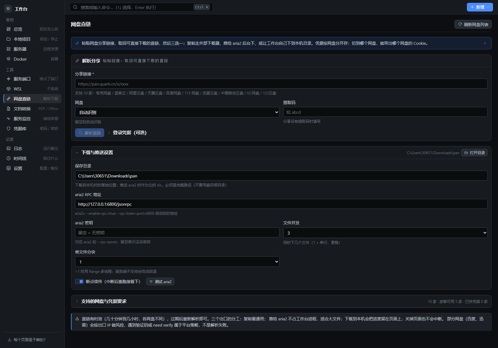
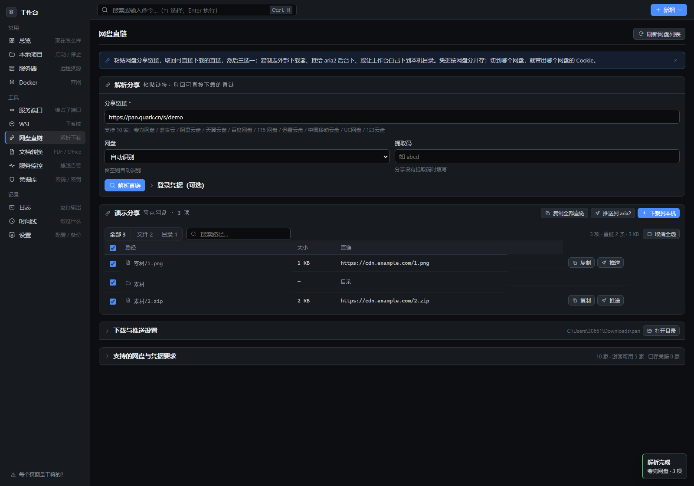

### 为什么是子进程而不是用 Node 重写

解析逻辑在 `tools/panlink`（零依赖 Python，10 家网盘的签名 / 风控流程已调通）。用 Node 重写一遍代价高、还容易在签名细节上出错，因此工作台只做「起进程 / 传凭据 / 解析输出」。

两个 Windows 专属坑写在 `panService.js` 顶部：Python 默认按控制台代码页写 stdout（中文 JSON 变 GBK），必须强制 `PYTHONIOENCODING=utf-8`；**凭据不能走命令行**（会出现在进程列表里），改用环境变量 `PAN_COOKIE` / `PAN_TOKEN` / `PAN_CAPTCHA_CODE` 传给子进程。服务端不落盘任何 cookie / token，前端按网盘分槽存在本机 localStorage。

### 下载任务的口径（写清楚，避免误判）

- **进度来自产物**：完成数以 `pan.py` 自己打印的「下载完成: 成功 A / 跳过 B / 失败 C」为准，中途的 `✓` 只用于即时显示；两者不一致时以汇总为准。
- **退出码语义**：`0` 全成功 / `2` 部分成功（任务算跑完，失败数如实保留）/ `1` 参数或前提问题（会明确提示「不是链接问题」）/ `3` 一条都没成功（多半链接失效或需要登录态）。
- **取消不删 `.part`**：已下部分是有效资产，重跑同一条命令能续传；删掉只会让人白等一遍。
- **保存目录必须写盘符**：Windows 上 `/tmp/x` 是「当前盘根 + tmp」这种相对盘符写法，界面显示 `\tmp\x`、文件却落到 `C://tmp//x`（实测踩到）。现在直接拒绝，并要求不是盘符根目录、不是 Windows 系统目录，启动前真的写一个探针文件确认可写。
- **并发上限 2 个任务**（`DSM_PAN_MAX_JOBS`），超出排队；服务重启后任务历史清空，**不做"恢复下载"的假承诺**（`.part` 还在，重跑即可）。

### 只下选中的文件

解析结果每一行都有勾选框，**默认全选**（不勾 = 整条分享，和以前一样）；取消勾选后三个出口立刻只处理选中的：

- 勾**目录行** = 勾它下面全部文件（一次选中整个文件夹）；
- 没有直链的行（取链失败）勾框置灰——勾了也下不动，置灰比隐藏更能说明问题；
- 三个按钮在非全选时带 `（N）` 后缀，工具栏脚注显示「已选 N（大小）」；
- 传给 `pan.py` 的是 `--only <路径>`（可重复）：**全选时反而省略**，行为与旧版逐字节一致；
- `pan.py` 对失配路径的处理：部分失配只警告（分享在解析后被更新过），
  全部失配按用法错误退出 1——脚本能区分「我参数给错了」和「链接失效了」。

### 迅雷验证码：不用离开工作台

迅雷风控触发图形验证码时，以前只能看到一句「用 --captcha-code 传入」——对 GUI 用户等于没办法。现在：

1. `panService` 每次解析都带 `--captcha-png`（临时目录里一个确定路径）；
2. 触发验证码时 `pan.py` 把图片写到那里，并向 stderr 打 `CAPTCHA_REQUIRED<TAB>路径`；
3. 后端读到标记就把图片读回来，以 **data URI 内嵌**在 400 响应里
   （`error.needsCaptcha` + `error.captchaImage`）——不额外开静态路由，也就没有目录穿越要防；
4. 前端弹出验证码卡：图片 + 输入框 + 「提交并重新解析」/「换一张」。
   图片读不到时**不弹卡**，按普通错误出去——顶着一张碎图让人白填比没有更糟。

### aria2 的两个细节

- **不用全局 `fetch`**：本机常开代理时，undici 的 `EnvHttpProxyAgent` 会把发往 `127.0.0.1` 的请求也塞进代理，表现为「aria2 明明在跑却 502」。服务入口虽然补了 `NO_PROXY`，但服务层不该依赖「谁先启动 / 环境变量长什么样」——RPC 直接用 `node:http`，天然不读代理变量（测试里显式设 `HTTP_PROXY` 后仍能连通，锁住这条）。
- **鉴权失败不是 HTTP 401**：aria2 用 `200 + JSON-RPC error{message:"Unauthorized"}` 表示密钥错，只看状态码会把它当普通业务错误。现在翻成「密钥不对，请核对 --rpc-secret」。

推送时的 `out` 取文件名（aria2 的 `out` 不能再带目录分隔符），同名文件自动改成 `1 (2).zip`；非法字符替换为 `_`。

### 内嵌副本怎么保持同步

`tools/panlink` 是 `pan.py` 源项目的**副本**，不手工 cp：

```bash
node scripts/sync-panlink.mjs <pan.py 所在目录>          # 同步（写 tools/panlink/SYNC.json 记录指纹）
node scripts/sync-panlink.mjs <pan.py 所在目录> --check   # 只比对，有漂移退出 1（放进 CI 或发版前跑）
```

上一版就是靠手工拷贝维护，结果工作台停留在 8 家网盘、源头早已 10 家，界面文案与实际能力长期不一致——现在同步是一条命令，且有 `pans.test.mjs` 的契约断言守着（`--list-pans --json` 结构、下载/推送用到的参数是否存在）。

---

## 二十、本地影院：海报墙 · 点开即播 · AI 修复

把之前做的「本地私人影院 2.0」接进工作台。它是一套**纯 Python 标准库**实现的本地影音服务（约 2700 行）：把视频文件丢进片库文件夹就是海报墙，点开即播、可拖进度、边下边播、自动记忆续播；能用显卡做 Real-ESRGAN 逐帧超分；能聚合搜索 Apple CMS 源；能用 yt-dlp 把公开视频链接抓进片库。

工作台不做重写，只做**托管**：用 `tools/mediaserver` 下的代码起一个独立子进程，提供启动 / 停止 / 探活 / 打开片库目录 / 日志，运行态时整页内嵌影院本体（iframe，只听 `127.0.0.1`，不对外）。

| 能力 | 说明 |
| --- | --- |
| **海报墙 / 点开即播** | 视频进 `library/` 即出现，Range 流式播放、断点续播、记住上次看到哪 |
| **AI 逐帧修复** | Real-ESRGAN 超分（2x/3x/4x），后台任务队列，成品自动入库（需要 `tools/upscaler`，随影院一起收进 `tools/`） |
| **聚合搜索** | Apple CMS V10 多源并行搜索 + m3u8 代理改写，采集源由你自己填 |
| **下载入库** | yt-dlp 抓公开视频链接直接进片库（可选，没装时徽标置灰） |

### 怎么用

工作台「本地影院」页点「一键启动」（纯 Python，不需要装依赖）→ 把视频丢进片库目录（mp4 / mkv / webm / mov / ts / avi，支持子文件夹）→ 刷新页面点封面即播。想换片库位置用 `DSM_MEDIA_LIBRARY`，超分工具位置用 `DSM_MEDIA_UPSCALER`（`MEDIA_LIBRARY_DIR` / `MEDIA_UPSCALER_DIR` 环境变量亦可）；改端口用 `DSM_MEDIA_PORT`（默认 8888，被占自动顺延）。

### 接入要点（对应真实翻车点）

- **子进程 `detached` + 输出写日志文件**：工作台退出不影响影院继续放；运行态落盘 `data/media.json`，重启后能认领已在运行的实例（看响应头 `Server: LocalCinema/2.0` 认领，不重复起一份）。
- **本机探测一律 `node:http` 并强制 `Connection: close`**：本机若设了 HTTP 代理，undici 会把 `127.0.0.1` 也误导向代理；keep-alive 复用还会让第二次 `/api/list` 探测静默丢弃（真实 Python 与 node 假服务都踩过）。强制短连接最稳。
- **端口避让 + 认领**：默认 8888，被占就顺延；若占用者就是自家实例（你曾双击过 `start.bat`）直接认领。
- **能力标志以影院自己的 `/api/list`、`/api/dl` 为准**：AI 修复 / 海报 / yt-dlp 是否就绪，单一事实来源，不跟 Python 侧各判一遍产生漂移。
- **停止结束整棵进程树**：影院会派生 ffmpeg / yt-dlp / 超分子进程，`taskkill /T /F` 连锅端，再等端口真的释放（`stop` 返回 `portReleased`）。

### 内嵌副本怎么保持同步

`tools/mediaserver` 与 `tools/upscaler` 是源项目的**副本**（随仓库走，不手工维护），`media.test.mjs` 的契约断言守着文件形状、`PORT` / 目录覆盖 / 只绑 `127.0.0.1` / 编译通过。

---

## 十九、许可与相关文档

- 许可证：[MIT](LICENSE)
- 版本与变更记录：[CHANGELOG.md](CHANGELOG.md)
- 贡献方式与开发约定：[CONTRIBUTING.md](CONTRIBUTING.md)
- 漏洞报告与凭据约定：[SECURITY.md](SECURITY.md)
- 技术选型与分阶段实现细节：[docs/01-技术方案.md](docs/01-技术方案.md)
- 接口清单：[docs/02-接口清单.md](docs/02-接口清单.md)
- 任务日志归档（第六阶段需求的来源、执行过程与验收记录）：[docs/03-任务日志归档.md](docs/03-任务日志归档.md)
- 环境变量：[.env.example](.env.example)（本项目不引入 dotenv，请导出到进程环境）；本地凭据文件示例：[data/secrets.example.json](data/secrets.example.json)
